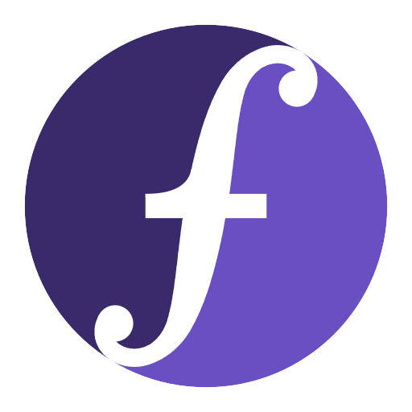

# clotran

Clojure, hosted on Fortran.

It runs Rich Hickey's actual `clojure/core.clj`, vendored from
`clojure/clojure` at the `clojure-1.12.6` release, with every class
written in clotran's name -- a mechanical rewrite, `upstream/derive`. Not a Clojure-like
language implemented in Fortran: the Fortran is the *host*, standing
where clj stands, and the language comes from Clojure's own source.

## Install

On macOS (arm64) or Linux (aarch64 or x86_64, glibc or musl), into
`~/.local`:

```
$ curl -fsSL https://raw.githubusercontent.com/jborden/clotran/main/install.sh | sh
```

On Windows (x86_64), from PowerShell, into
`%LOCALAPPDATA%\Programs\clotran` with its `bin` on your PATH:

```
> irm https://raw.githubusercontent.com/jborden/clotran/main/install.ps1 | iex
```

Each checks the download against the release's `SHA256SUMS`
(`RELEASE-NOTES.md`). From a checkout, `make && make install` builds it
and installs it into `~/.local` (`docs/building.md`).

## Getting started

`clotran` with no arguments is a REPL:

```
$ clotran
user=> (defn greet [who]
  #_=>   (str "hello, " who))
#'user/greet
user=> (greet "world")
"hello, world"
user=> (->> (range 20) (filter odd?) (partition-all 3) (map vec))
([1 3 5] [7 9 11] [13 15 17] [19])
user=> (clojure-version)
"1.12.6"
```

A file is a program, run as with `clj -M`; a project has a `deps.edn`:

```
$ clotran app.cljf a "b c"            # *command-line-args* is ("a" "b c")
$ clotran new my-app                  # deps.edn, src/my_app/core.cljf, a test
$ cd my-app && clotran test           # every -test namespace under test/
```

With a `-main` in `my-app.core`, `clotran -m my-app.core a b` calls it,
and `clotran build -m my-app.core -o my-app` makes one executable that
runs with no clotran installed (`docs/guide.md`).

**Fortran arrays.** The `fortran` namespace makes real Fortran arrays:
contiguous, column-major, at an address the collector never moves:

```clojure
(alias 'f 'fortran)
(def m (f/make-array "real8" 2 3))    ; zero-filled
(f/aset m 1 2 3.5)
(f/aget m 1 2)                        ;=> 3.5
(f/array-shape m)                     ;=> [2 3]
```

**Calling your own Fortran.** Any free-form module, written with no
thought of clotran, becomes a package: `scripts/bind-fortran` reads its
signatures and writes the shims, your compiler builds a shared library,
and clotran opens it at run time. `examples/mylib/mylib.f90`:

```fortran
module mylib
  implicit none
contains
  subroutine scale(n, a, x)
    integer, intent(in) :: n
    real(8), intent(in) :: a
    real(8), intent(inout) :: x(n)
    x = a * x
  end subroutine scale

  real(8) function norm2sq(n, x)
    integer, intent(in) :: n
    real(8), intent(in) :: x(n)
    norm2sq = sum(x * x)
  end function norm2sq
end module mylib
```

From a checkout (`bind-fortran` is a [babashka](https://babashka.org)
script), in `examples/mylib` (`.so` on Linux, `.dll` on Windows):

```
$ ../../scripts/bind-fortran --package mylib --out mylib_bind.f90 mylib.f90
$ mkdir -p mylib && gfortran -shared -fPIC -o mylib/libmylib.dylib mylib.f90 mylib_bind.f90
$ clotran demo.cljf
[2.0 4.0 6.0]
56.0
```

where `demo.cljf` is

```clojure
(fortran/load-package "mylib")        ; ./mylib/libmylib.dylib
(def x (double-array [1 2 3]))
(mylib.raw/scale 3 2.0 x)             ; x is :inout -- scaled in place, no copy
(println (vec x))
(println (mylib.raw/norm2sq 3 x))
```

The array crosses as the buffer it is: no copy, no descriptor, no C
written by hand. `make test` builds and runs this example. The reference
BLAS (`packages/blas`) and ChemSol, a real solvation code
(`packages/chemsol`), are packages the same way; `PACKAGES.md` says how.

`docs/guide.md` goes on from here: projects and dependencies, Clojure's
own arrays over the same buffers, embedding clotran in a Fortran
program, compiling a namespace to Fortran, the debugger, futures,
agents and threads.

## Why

Clojure in clj can already call Fortran -- but only the 1978
subset. Everything an FFI bridge reaches is F77: scalars by reference,
explicit-shape arrays, no modules. Above that there is no Fortran ABI:
an assumed-shape array, an `allocatable`, an `optional` argument are
passed as a compiler-private descriptor that differs between gfortran,
flang and ifx, and module names are mangled per compiler. `bind(c)`
gets around it by promising not to use the parts of Fortran written
after 1990.

Hosting *on* Fortran removes the boundary instead of crossing it. A
clotran array is a Fortran array, so handing it to a library is an
ordinary call -- and the language on top is still Clojure, from
Clojure's own source, checked against `clj` itself. `docs/rationale.md`
has the long version, with what it costs.

## More

- `docs/guide.md` -- using clotran, feature by feature
- `docs/status.md` -- what works (measured), what does not, the version policy
- `docs/building.md` -- building from source on macOS, Linux and Windows; the layout
- `docs/rationale.md` -- why Fortran
- `DEVIATIONS.md` -- every place clotran differs from Clojure, and why
- `SEAMS.md`, `PACKAGES.md`, `PLAN.md`, `NOTES.md`, `RELEASE-NOTES.md`

## License

clotran is EPL-2.0 (`LICENSE`).

It redistributes Clojure (EPL-1.0) and ICU4C (Unicode License v3), each
under its own license. `NOTICE` says which is which; neither is
relicensed by this repository.
